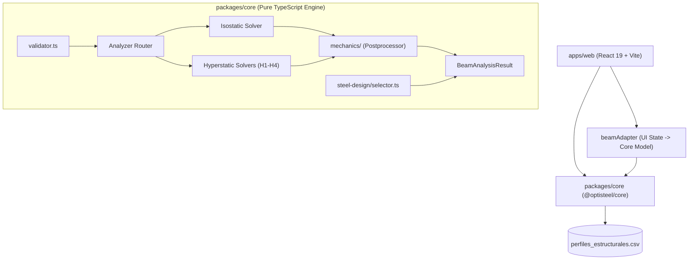
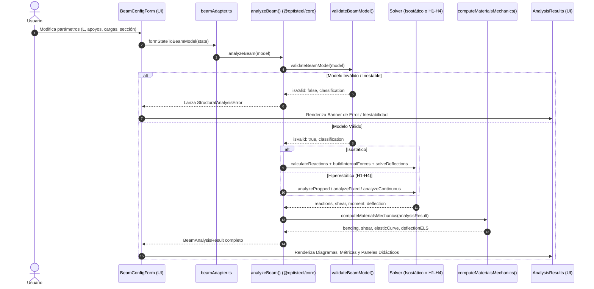

# OptiSteel 2.0 — Guía de Arquitectura del Monorepo

## 1. Visión General de la Arquitectura

OptiSteel 2.0 está estructurado como un **monorepo desacoplado en TypeScript** administrado mediante **pnpm workspaces**. Su diseño garantiza la separación total entre la lógica analítica de cálculo estructural y la capa de presentación interactiva de usuario.

---

## 2. Responsabilidad de los Paquetes

### 2.1. `@optisteel/core` (Motor de Cálculo Analítico)
* **Ubicación:** `packages/core/`
* **Naturaleza:** Biblioteca en TypeScript puro, compilada a ECMAScript Modules (`dist/index.js`) con declaraciones de tipos (`dist/index.d.ts`).
* **Dependencias de runtime:** Cero (0). No depende de React, DOM, Canvas ni Node.js APIs privativas.
* **Responsabilidades:**
  1. **Validación y Estabilidad:** Verifica coherencia de longitudes, cargas en dominio y clasificación estática (isostático, hiperestático o inestable).
  2. **Resolución Estática:** Cálculo de reacciones en apoyos y verificación rigurosa de equilibrio estático ($\sum F_y = 0, \sum M = 0$).
  3. **Fuerzas Internas Continuas:** Generación de tramos analíticos continuos para $V(x)$ y $M(x)$ con búsqueda de singularidades y extremos.
  4. **Solvers Hiperestáticos Canónicos H1–H4:** Resolución cerrada basada en compatibilidad elástica y reporte didáctico paso a paso.
  5. **Mecánica de Materiales (`src/mechanics/`):** Cálculo de esfuerzos de flexión $\sigma$ (con extremos duales $M^+/M^-$), cortante $\tau$ (Jourawski en eje neutro, promedio en alma, promedio en sección), constantes de integración y curva elástica continua, y verificación ELS particionada por vanos.
  6. **Dimensionamiento Preliminar de Acero (`src/steel-design/`):** Selector iterativo de perfiles W, S y C con recálculo automático de peso propio.

### 2.2. `@optisteel/web` (Aplicación Web React + Vite)
* **Ubicación:** `apps/web/`
* **Naturaleza:** Single Page Application (SPA) en React 19 empaquetada mediante Vite 6.
* **Responsabilidades:**
  1. **Captura Paramétrica:** Formularios reactivos para definición de vigas, apoyos, cargas y propiedades de material y sección.
  2. **Adaptador de Datos (`src/adapters/beamAdapter.ts`):** Transforma el estado plano del formulario en un `BeamModel` fuertemente tipado.
  3. **Visualización Gráfica:** Esquema estructural interactivo en SVG (`BeamSchematic`), diagramas continuos de solicitaciones y curva elástica.
  4. **Paneles Didácticos:** Desglose matemático interactivo en `MaterialsMechanicsPanel.tsx`, tabla de puntos notables y reporte didáctico de compatibilidad elástica.
  5. **Biblioteca Canónica:** Interfaz para seleccionar y transferir los 12 casos analíticos de Pytel-Singer.
  6. **Selector Interactivo de Perfiles:** Tabla dinámica con filtros por familia (W, S, C), indicadores de aprovechamiento y ordenamiento por peso.

---

## 3. Flujo de Datos y Pipeline de Análisis

El flujo de ejecución desde que el usuario interactúa con la interfaz hasta la visualización de resultados sigue una secuencia lineal y determinista:

---

## 4. Estructura de Tipos Compartidos (`packages/core/src/types.ts`)

Los contratos de datos fundamentales entre el motor y la UI se definen formalmente:

* `BeamModel`: Representación agnóstica de la viga (longitud, apoyos `Support[]`, cargas `Load[]`, `material?: BeamMaterial`, `section?: BeamSection`).
* `FunctionAnalysis<T>`: Estructura de fuerzas internas por tramos con funciones de evaluación continua, discontinuidades, raíces (cortes con cero) y extremos absolutos/relativos.
* `DeflectionAnalysis`: Solución analítica continua de pendientes $\theta(x)$ y deflexiones $y(x)$ con rigidez flexionante $EI$.
* `BeamAnalysisResult`: Objeto inmutable consolidado que contiene modelo, equilibrio, reacciones, cortante, momento, deflexión, reporte didáctico hiperestático y resultados de resistencia de materiales (`MaterialsMechanicsResult`).

---

## 5. Módulo de Mecánica de Materiales (`packages/core/src/mechanics/`)

Submódulo estructurado en servicios especializados:

1. **`bending.ts` (`calculateBendingStress`):** Aplica la formulación de Navier $\sigma = M / W_z$. Evalúa de forma independiente los extremos positivo ($M^+$, sagante) y negativo ($M^-$, hogante), caracterizando el estado de tracción o compresión de las fibras superior e inferior.
2. **`shear.ts` (`calculateShearStress`):** Distingue inequívocamente entre cortante promedio de sección $V/A$, cortante medio de alma en perfiles de acero $V/(d \cdot t_w)$ y cortante elástico máximo en el eje neutro $\frac{V \cdot Q}{I \cdot t_w}$ (Jourawski / Colignon).
3. **`elastic-curve.ts` (`buildElasticCurveResult`):** Extrae las condiciones de frontera físicas, constantes de integración $C_1, C_2$ y expresiones polinómicas tramo a tramo.
4. **`deflection.ts` (`calculateDeflectionExtremum`):** Realiza la descomposición topológica en vanos independientes (`extractBeamSpans`), evaluando límites ELS específicos ($L_i/n$ para vanos y $2a/n$ para voladizos).
5. **`postprocessor.ts` (`computeMaterialsMechanics`):** Orquestador que consolida todos los análisis mecánicos sobre el resultado del solver.

---

## 6. Flujo y Estrategia de Pruebas

El monorepo cuenta con una suite integral de **223 pruebas automatizadas** ejecutadas con **Vitest**:

* **Pruebas de Core (174 tests):**
  * `catalog-integrity.test.ts`: Integridad del catálogo CSV de perfiles de acero.
  * `pytel-singer-all-12-cases.test.ts`: Validación analítica de los 12 casos canónicos de Pytel-Singer frente a sus fórmulas cerradas.
  * `hyperstatic-solver.test.ts`: 61 pruebas unitarias y de regresión para casos H1–H4.
  * `materials-mechanics.test.ts`: 30 pruebas para Navier, Jourawski, ELS por vanos y momentos duales.
  * `steel-selector.test.ts`: 34 pruebas para el selector óptimo y el recálculo por peso propio.
  * `validator-and-stability.test.ts` / `equilibrium.test.ts` / `deflection-solver.test.ts`: Pruebas de compatibilidad estática.
* **Pruebas de Web (49 tests):**
  * `app.test.tsx` / `materials-mechanics-ui.test.tsx`: Renderizado interactivo de métricas y paneles.
  * `hyperstatic-web.test.tsx`: Validación de reportes didácticos y casos H1–H4 en la interfaz.
  * `steel-profile-selector.test.tsx`: Interacción y recálculo reactivo del selector.
  * `responsive.test.tsx`: Adaptabilidad responsive para escritorio, tablet y móvil.

