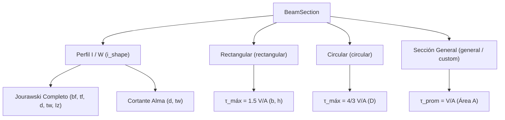

# OptiSteel 2.0 — Geometría Seccional, Modelos de Perfil y Limitaciones

## 1. Tipologías Seccionales Soportadas

OptiSteel 2.0 admite diferentes modelos de sección transversal en [`packages/core/src/types.ts`](file:///c:/Users/amaur/Desktop/OptiSteelProject/packages/core/src/types.ts#L45) (`BeamSection`), procesándolos según la cantidad y calidad de información geométrica provista:

---

## 2. Modelos Geométricos Específicos

### 2.1. Perfiles Estructurales I / W (`type: 'i_shape'`)
* **Parámetros requeridos para cálculo elástico completo:**
  - $d$ (`heightMm`): Peralte o altura total del perfil ($\text{mm}$).
  - $b_f$ (`flangeWidthMm`): Ancho de las alas ($\text{mm}$).
  - $t_f$ (`flangeThicknessMm`): Espesor de las alas ($\text{mm}$).
  - $t_w$ (`webThicknessMm`): Espesor del alma ($\text{mm}$).
  - $I_z$ (`Iz`): Momento de inercia baricéntrico respecto al eje fuerte ($\text{cm}^4$).
* **Propiedades derivadas:**
  - Distancia a la fibra extrema: $c = d / 2$ ($\text{mm}$).
  - Módulo de sección elástico: $W_z = \frac{I_z \times 10}{c}$ ($\text{cm}^3$).
  - Área total de la sección: $A \approx 2(b_f \cdot t_f) + (d - 2t_f) t_w$.
  - Primer momento de área en el eje neutro ($Q_{\text{máx}}$):
    $$Q_{\text{máx}} = b_f t_f \left(\frac{d - t_f}{2}\right) + \frac{t_w (d - 2t_f)^2}{8} \quad [\text{mm}^3]$$
  - Cortante máximo elástico en el eje neutro:
    $$\tau_{\text{máx}} = \frac{|V| \cdot 10^3 \cdot Q_{\text{máx}}}{(I_z \cdot 10^4) \cdot t_w} \quad [\text{MPa}]$$

### 2.2. Sección Rectangular Maciza (`type: 'rectangular'`)
* **Parámetros requeridos:**
  - $b$ (`widthMm`): Base o ancho de la viga ($\text{mm}$).
  - $h$ (`heightMm`): Altura o peralte de la sección ($\text{mm}$).
* **Propiedades analíticas:**
  - Área transversal: $A = \frac{b \cdot h}{100}$ ($\text{cm}^2$).
  - Distancia a la fibra extrema: $c = h / 2$ ($\text{mm}$).
  - Momento de inercia: $I_z = \frac{b \cdot h^3}{12 \times 10^4}$ ($\text{cm}^4$).
  - Módulo elástico: $W_z = \frac{b \cdot h^2}{6 \times 10^3}$ ($\text{cm}^3$).
  - Cortante máximo: $\tau_{\text{máx}} = 1.5 \cdot \tau_{\text{prom}} = \frac{1.5 \cdot |V| \times 10^3}{b \cdot h}$ ($\text{MPa}$).

### 2.3. Sección Circular Maciza (`type: 'circular'`)
* **Parámetros requeridos:**
  - $D$ (`diameterMm`): Diámetro de la barra ($\text{mm}$).
* **Propiedades analíticas:**
  - Área transversal: $A = \frac{\pi D^2}{4 \times 100}$ ($\text{cm}^2$).
  - Distancia a la fibra extrema: $c = D / 2$ ($\text{mm}$).
  - Momento de inercia: $I_z = \frac{\pi D^4}{64 \times 10^4}$ ($\text{cm}^4$).
  - Módulo elástico: $W_z = \frac{\pi D^3}{32 \times 10^3}$ ($\text{cm}^3$).
  - Cortante máximo en el eje neutro: $\tau_{\text{máx}} = \frac{4}{3} \cdot \tau_{\text{prom}}$ ($\text{MPa}$).

### 2.4. Sección General con Propiedades Directas (`type: 'general'`)
* **Parámetros suministrados directamente:**
  - $I_z$ (`Iz`): Momento de inercia ($\text{cm}^4$).
  - $W_z$ (`Wz`): Módulo elástico ($\text{cm}^3$) o $c$ (`cMm` en $\text{mm}$).
  - $A$ (`areaCm2`): Área transversal ($\text{cm}^2$).
* En este caso, OptiSteel calcula el esfuerzo de flexión exacto mediante $\sigma = |M| / W_z$ y el cortante promedio $\tau_{\text{prom}} = |V| / A$. No evalúa $\tau_{\text{máx}}$ sin conocer las funciones geométricas de ancho local $b(y)$ y primer momento $Q(y)$.

---

## 3. Limitación Técnica de Simetría Seccional ($c = h/2$)

> [!WARNING]
> **HIPÓTESIS DE SIMETRÍA RESPECTO AL EJE NEUTRO:**  
> Cuando el usuario suministra el peralte total $h$ pero no especifica la posición del centroide baricéntrico ni las distancias a las fibras extremas ($c_{\text{sup}}, c_{\text{inf}}$), OptiSteel 2.0 asume simetría respecto al eje de flexión:
> $$c_{\text{sup}} = c_{\text{inf}} = \frac{h}{2}$$
> Esta hipótesis es rigurosamente exacta para:
> * Perfiles doblemente simétricos tipo I y H (perfiles W, S, HP, IPN, IPE, HEB).
> * Tubos estructurales rectangulares y cuadrados (HSS).
> * Secciones rectangulares y circulares sólidas.
>
> **Para secciones asimétricas o monosimétricas** (ej. perfiles T, ángulos L, perfiles C en flexión sobre eje débil o secciones cajón asimétricas), el centro de gravedad no coincide con la semialtura. En estos casos, el usuario **debe ingresar directamente el módulo elástico $W_z$ crítico o la distancia $c$ correspondiente a la fibra más solicitada**, tal como advierte la aplicación en sus notas didácticas.

